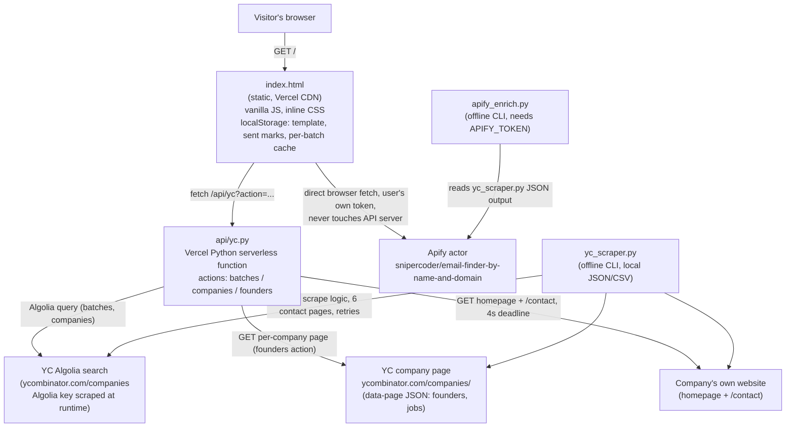

# yc-outreach — Architecture (2026-10-23)

Scope: real current system only (no proposed components). Covers what `PLAN-2026-10-23-DEEP.md` does not: competitive positioning was covered in `STRATEGY-2026-10-23.md`; this doc covers technical architecture, data flow, and risks.

## Confirmed facts (read from repo, not assumed)

- Hosting: **Vercel** (`.vercel/project.json` → `projectName: yc-outreach`; `vercel.json` sets a 60s timeout on `api/yc.py`). This is NOT one of the portfolio's Oracle boxes and NOT Cloudflare Workers/Pages — it is Vercel's Python serverless runtime.
- Git remotes: `origin` = `adityajha2005/yc-outreach` (upstream, not ours), `fork` = `caelum0x/yc-outreach` (ours). 13 commits total on `main`.
- No database. No queue/broker. No CI config (no `.github/workflows`, no `package.json`). Stdlib-only Python, zero npm dependencies.
- No `.env` committed; `APIFY_TOKEN` (CLI-only) is read from env or a gitignored local `.env`.

## 1. System diagram

No message queue, no persistent datastore, no auth layer. The only "cache" tiers are: Vercel edge `Cache-Control: s-maxage` headers on API responses, and the browser's `localStorage`.

## 2. Data flow for the 2-3 key user actions

### A. Load a batch's companies (click "Load companies")
1. Browser reads `tpl`/`sent`/per-batch cache from `localStorage` (key `yc-outreach-v2-batch-<batch>`).
2. If not cached: browser `fetch("/api/yc?action=companies&batch=...")`.
3. `api/yc.py` validates `batch` against `BATCH_RE`, calls `algolia()` → scrapes YC's Algolia app-id/key from `ycombinator.com/companies` (cached per warm Lambda instance in `_algolia` global), queries `YCCompany_production` index, paginates until `nbPages` exhausted.
4. Response (list of `{name, slug, website, one_liner, industry, team_size, launched_at}`) returned with `Cache-Control: s-maxage=3600`.
5. Browser sorts by `launched_at` desc, writes the array to `localStorage`, renders list skeleton, then immediately calls `loadMore()`.

### B. Load founders + open roles for 20 companies ("Load more")
1. Browser batches the next 20 un-fetched slugs into 2 parallel requests of 10 slugs each: `fetch("/api/yc?action=founders&slugs=a,b,c...")`.
2. `api/yc.py` validates slug count/format, fans out via `ThreadPoolExecutor` to `founders(slug)` per slug:
   - `GET https://www.ycombinator.com/companies/<slug>` → regex-extracts the `data-page="..."` JSON blob → `props.company` (founders, website, socials) and `props.jobPostings`.
   - Submits `site_emails(website, domain)` to a long-lived 32-thread pool with a **4-second** deadline; on timeout the result is simply dropped (`cf.TimeoutError` → `emails = []`), guesses still populate.
   - `site_emails` fetches homepage + `/contact` (2 pages, not the CLI's 6), extracts plain-text emails and Cloudflare `data-cfemail` obfuscated addresses (`cf_decode`), filters to the company's own domain.
   - DNS-resolves the domain (`socket.getaddrinfo`) before generating `first@`, `first.last@`, `flast@`, `firstlast@` guesses — skips guesses entirely if the domain doesn't resolve.
3. Response cached `s-maxage=86400` (24h) at the edge; merged into the browser's `ALL`/`DATA` arrays and written back to `localStorage` so a reopened batch never re-fetches.
4. Client renders each company's best-available contact: `apify verified > apify unverified > site email > guess > none`.

### C. Verified-email enrichment ("Find emails", optional)
1. Browser reads the **visitor's own** Apify token from an `<input type=password>` (never sent to `api/yc.py`, never persisted to `localStorage`).
2. Browser batches up to 50 founders per call, `POST https://api.apify.com/v2/acts/snipercoder~email-finder-by-name-and-domain/runs?maxTotalChargeUsd=<cap>` directly from the client, polls run status every 5s, then `GET .../datasets/<id>/items`.
3. Matches returned items back to founders by lowercased name+domain, writes `apify_email`/`apify_status` onto the in-memory + `localStorage`-persisted company objects, re-renders.
4. This path never touches the Vercel function — it is the deliberate trust boundary the README documents ("token never reaches this site's server").

### D. Offline bulk export (CLI path, out of band)
1. `python3 yc_scraper.py --batches "..." --out yc_founders` — same Algolia/data-page/cf-decode logic, but 6 contact paths, HTTP retries, no serverless time limit; writes local JSON+CSV (gitignored, never committed).
2. `python3 apify_enrich.py --input yc_founders.json` — reads that JSON, calls the same Apify actor server-side with `APIFY_TOKEN` from env/.env, writes an enriched JSON+CSV. Separate code path from the browser's Apify call; duplicated by design (different timeout/retry needs), per README's "Notes for AI agents."

## 3. Real architectural risks / bottlenecks (current scale, zero budget)

- **Single point of failure: scraping YC's own page markup.** Both `batches`/`companies` and `founders` depend on regex-extracting `window.AlgoliaOpts` and `data-page="..."` from YC's HTML. Any YC frontend redeploy that changes either string breaks the entire product with no fallback and no alerting (no monitoring exists at all).
- **Cold-start + per-request Algolia key fetch.** `_algolia` is cached only per warm Lambda instance; every cold start re-fetches `ycombinator.com/companies` before the first real query, adding latency and an extra outbound call that can itself fail (YC rate-limiting or blocking the function's IP/UA would silently take down `batches`/`companies` for all users).
- **No rate limiting or abuse protection on `api/yc.py`.** `MAX_SLUGS=10` caps one call's fan-out, but nothing stops a scripted client from hammering `action=founders` across many slugs/IPs — each call makes 10 outbound HTTPS requests to YC plus up to 10 company-website fetches. On Vercel's free/hobby tier this risks hitting function-invocation or bandwidth limits and taking the whole site down for real users, with no WAF or CAPTCHA in front of it.
- **4-second site-check deadline silently degrades data quality, not just speed.** `SITE_DEADLINE=4` means any company on a slow host (common for early-stage startups on cheap hosting) gets `emails = []` and the user only ever sees a pattern guess — there's no retry, no backoff, no way to know afterward which companies were skipped for being slow vs. having no email at all.
- **No backend persistence means no cross-session/cross-device state.** All "sent" marks, loaded batches, and the outreach template live in one browser's `localStorage`. Clearing site data, switching devices, or using a different browser loses everything — there is no account system (by design, for the free/no-signup pitch), but it also means the product cannot build any retention mechanism beyond the batch-cadence idea in the strategy doc without adding real backend state.
- **Two independent scrape implementations (`api/yc.py` vs `yc_scraper.py`) will drift.** They already differ deliberately (2 vs 6 contact paths, timeouts, retries) but share no common module — a YC markup change or a bug fix in the email regex/guess logic has to be applied twice or will quietly diverge.
- **Zero observability.** No logs are collected anywhere beyond Vercel's default function logs; a broken scrape (e.g., YC changes the Algolia key format) would only be noticed by a user reporting "batch won't load," with no server-side error tracking to catch it first.

## 4. Prioritized next-build list (effort vs. impact)

1. **Add a YC-markup health check + graceful fallback message** (low effort, high impact). A tiny scheduled check (even a manual pre-deploy `curl`) that asserts the Algolia-key regex and `data-page` regex still match, plus a user-facing "YC changed their page, we're on it" error string instead of a raw 502 — turns the single point of failure from silent breakage into a known, fast-to-fix incident. Directly protects every growth move: a broken tool during a Show HN/Reddit launch spike is the single worst outcome.
2. **Extract the shared scrape/decode logic (`cf_decode`, `site_emails`, `guesses`, Algolia client) into one importable module used by both `api/yc.py` and `yc_scraper.py`** (low-medium effort, medium-high impact). Removes the drift risk called out above and makes the planned Gmail-send port (growth move #1 in the strategy doc) safer to build on, since it will need to reuse the same founder/email data shape.
3. **Add minimal per-IP rate limiting on `api/yc.py`** (low-medium effort, high impact for the zero-budget constraint). Even a simple in-memory/edge-cache token count (Vercel supports `@vercel/edge-config` or a cheap header-based throttle) prevents one scripted client from exhausting the Vercel hobby-tier invocation/bandwidth quota and taking the whole site down — the one failure mode that would zero out all users at once, which matters most right before a distribution push.
4. **Port lakshh07/yc-outreach's Gmail-send into `index.html`** (medium effort, high impact — this is strategy growth move #1). Architecturally this is additive: a new client-side OAuth flow calling Gmail's API directly from the browser, following the same trust pattern already proven by the Apify integration (token/credential never touches `api/yc.py`). Removing the copy-paste step is the single highest-leverage change to conversion from "tool used" to "email actually sent."
5. **Instrument basic server-side error logging/alerting for `api/yc.py` failures** (low effort, medium impact). Vercel's function logs already exist but nothing surfaces a spike in 502s; even a free-tier log-drain or a simple "ping me if error rate > X" check closes the observability gap before traffic grows from the planned Reddit/HN/cross-fork distribution push.
